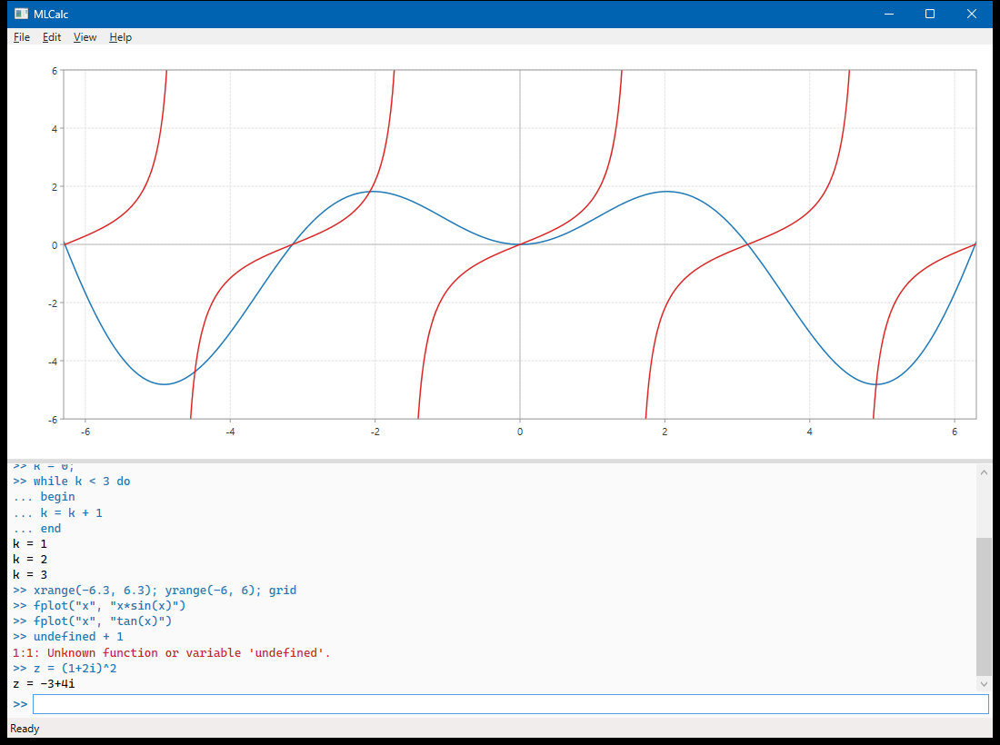

# MLCalc

> **Disclaimer:** MLCalc is a personal project, provided "as is" and without any warranty. Like
> all software, it may contain bugs, so its results can be wrong. Do not use MLCalc where an
> incorrect result is not acceptable, for example in medical, safety-critical, engineering,
> financial or legal work. If a result matters, check it with another method or tool. The full
> terms are in the [MIT license](LICENSE).

MLCalc is a scientific calculator and plotting program with its own small scripting language.
It was first written in C for the Amiga in the mid-1990s. This repository is a modern C#/.NET
re-implementation, starting with a WPF desktop front-end.

Every value in MLCalc is a complex matrix: scalars are 1×1 matrices and real numbers are complex
numbers with a zero imaginary part.



## The language

```
A = [1, 2; 3, 4]           % matrices: ',' or space between elements, ';' or newline between rows
A * [1; 1]                  % matrix product; .* ./ .^ work element by element
z = (1 + 2i)^2              % complex numbers
t = 0:0.1:2*pi;             % ranges; ';' suppresses output
x = A(2, :)                 % indexing is 1-based; ':' selects a whole row or column

for k = 1:5                 % MATLAB-style blocks: if … elseif … else … end, while … end, for … end
	if mod(k, 2) == 0
		disp("even")
	else
		disp(k)
	end
end

k = 0;
while k < 3 do              % the original style: if … then … else, while … do, for k = 1 to 10 do,
begin                       % with a single statement or begin … end as the body
	k = k + 1
end

xrange(-6.3, 6.3); yrange(-6, 6); grid
fplot("x", "x*sin(x)")      % functions are given as strings
plot(t, sin(t), +)          % styles: - (line), + (crosses), * (stars)
p = polyfit(t, cos(t), 4); polyplot(p)
solve("x", "x^2 - 2", 1)    % also integral, derivata, isect, extreme, feval
```

Names are case-insensitive. **Help › List Functions** shows every function and command.
The [user's manual](docs/manual.md) describes every operator, function and command, and the full
syntax is described in EBNF in [docs/grammar.md](docs/grammar.md).

## Using the app

- Type an expression and press **Enter**. Unfinished input (an open `begin`, bracket or
  `while … do`) continues on the next line with a `...` prompt; an empty line forces evaluation.
- **Up/Down** recall earlier input, **Esc** stops a running script (or discards unfinished input).
- Run a script by typing its file name (e.g. `FEIGENBA.m`), with **File › Run Script** (Ctrl+O), by
  dropping a `.m` file on the window, or from the command line: `MLCalc --run script.m`.
- The original sample scripts are copied next to the executable, in `samples/`.
- `initdisplay(rows, columns)` splits the plot area; `currentwin(r, c)` selects a window.
- **File › Export Plot** (Ctrl+E) saves the plots as PNG (at twice the screen resolution) or SVG;
  **Edit › Copy Plot** (Ctrl+Shift+C) copies them as an image. In scripts, `savefig("plot.png")` or
  `savefig("plot.svg", width, height)` does the same (the command-line tool supports SVG only).

## Command line

`mlcalc` runs on Windows, Linux and macOS. Without arguments it starts an interactive prompt
(`help` for hints, Ctrl+C stops a running program, `exit` quits).

```
mlcalc script.m [more.m …]          run scripts; errors are reported as file:line:column
mlcalc -e "A = [1 2; 3 4]" -e "inv(A)"
echo "solve(\"x\", \"x^2-2\", 1)" | mlcalc
mlcalc FEIGENBA.m --svg feigenbaum.svg --size 1200x800
mlcalc script.m -i                   run a script, then continue interactively
```

The exit code is 0 on success, 1 when a program fails and 2 for invalid options, so `mlcalc` can be
used from shell scripts and builds.

## Differences from the Amiga original

- **Operators follow MATLAB.** `*`, `/`, `\` and `^` are matrix operations and `.*`, `./`, `.^`
  are element-wise. The original used `*` and `/` element-wise and `.*` for the matrix product.
  `'` is the conjugate transpose and `.'` the plain transpose.
- Several numerical routines were replaced with more robust methods (Brent's method for roots,
  Ridders' method for derivatives) and bugs in some complex inverse functions were fixed.

## Projects

| Project | Purpose |
|---|---|
| `MLCalc.Math` | Real and complex scalar functions |
| `MLCalc.LinearAlgebra` | Complex matrix type and linear algebra (Gauss elimination, least squares, polynomials) |
| `MLCalc.Numerics` | Numerical analysis: integration, differentiation, root finding |
| `MLCalc.Language` | Lexer, parser and syntax tree for the MLCalc language |
| `MLCalc.Plotting` | UI-independent plot model (figures, axes, series, layout) and SVG export |
| `MLCalc.Interpreter` | Evaluates MLCalc expressions and scripts |
| `MLCalc.Wpf` | Windows desktop application |
| `MLCalc.Cli` | Cross-platform command-line tool (`mlcalc`) |

The libraries target `net10.0` with no Windows dependencies, so they can be reused by other
front-ends. Dependencies only point downward: `Math` ← `LinearAlgebra` ← `Numerics` ← `Interpreter` ← `Wpf` / `Cli`.
`Language` and `Plotting` have no dependencies and are used by `Interpreter`; the front-ends also use `Plotting`.

`samples/` contains scripts written for the original Amiga version.

## Building

Requires the .NET 10 SDK.

```
dotnet build MLCalc.slnx
dotnet test MLCalc.slnx
dotnet run --project src/MLCalc.Wpf
dotnet run --project src/MLCalc.Cli -- -e "1 + 2"
```

## License

MIT — see [LICENSE](LICENSE).
